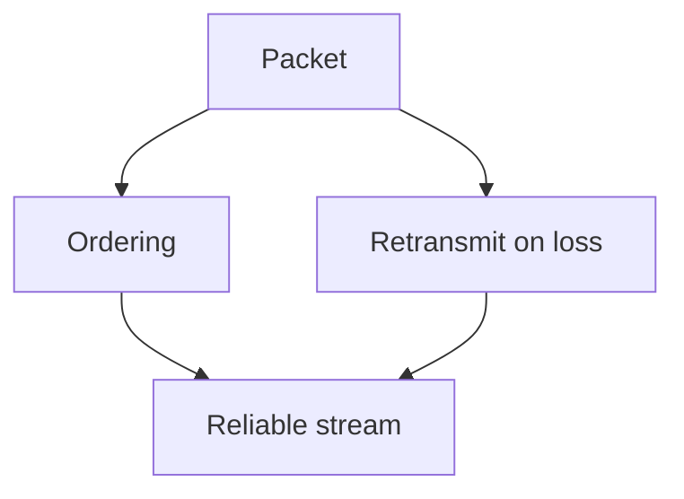

# Visualize

A picture earns its place only when it shows something words can't — shape, structure, direction, relationship, geometry. This skill produces ONE such picture and drops it into the lesson so it renders inline in Obsidian.

You are the **creative director**. You decide the exact idea and distill it to its fewest carrying elements. A **maker subagent** (spawned via `Agent`) does the authoring.

## When to visualize (and when not to)

This teaching system builds a **dependency graph in the learner's head** — axioms at the root, derived facts hanging off them. A visual is powerful exactly when it makes that structure (or a geometry) visible. Reach for one when:

- The idea is a **structure or relationship**: dependencies, a system with parts and arrows, a flow/pipeline, a sequence of exchanges, a state machine, a tree/hierarchy, a comparison, a containment (what's inside vs outside).
- The idea is **spatial or geometric**: coordinate geometry, a number line, vectors, a function's shape, a physical arrangement.

Do NOT visualize when prose or a single equation already carries it. A decorative diagram that just restates the sentence next to it adds noise and a chance to be wrong. When in doubt, don't — a missing visual is cheaper than a false one.

## Choose the format

Two formats, depending on the kind of visual:

- **Mermaid** — structural/relational visuals: dependency graphs, flowcharts, sequence/state/ER/class diagrams, trees, mindmaps, timelines. This is the default and fits the dependency-graph pedagogy directly. Obsidian renders mermaid code blocks natively — no external tools needed.
- **SVG file** — spatial/geometric visuals Mermaid can't lay out: exact coordinates, geometry figures, number lines, vectors, plots, custom shapes. Write the SVG to the vault's `Attachments/` folder and embed it.

Rule of thumb: if it's *nodes-and-edges / relationships*, use Mermaid. If it's *positions-and-shapes / geometry*, use SVG.

## Brief the maker well: one idea, fewest elements

The most common failure is **cramming** — every extra label makes the picture harder to read AND harder to lay out correctly. Before briefing (or writing), prune to the fewest elements that carry the idea, and for each ask: *"if I delete this, is the idea still clear?"* If yes, delete it.

- BAD: "make a diagram about how TCP works"
- GOOD: "graph TD: a node 'packet' at the top; arrows down to 'ordering' and 'retransmit on loss'; both arrows down into 'reliable stream'. No title. Show that reliability is built FROM packets, not alongside them."

Keep the idea intact but aim for ~5–7 elements max. Cut before composing.

## Producing the visual

### Mermaid (default)

Write the mermaid diagram directly in a fenced code block in your reply:

````

````

Obsidian renders this inline automatically. No file needed.

### SVG (geometric/spatial)

For visuals that need precise positioning, spawn an `Agent` subagent to author the SVG:

1. Brief the agent with the exact elements, positions, and relationships.
2. The agent writes the SVG file to the vault's `Attachments/` folder with a descriptive filename: `viz-<slug>-<timestamp>.svg`.
3. Embed it in your reply with Obsidian's wikilink syntax:

```
![[viz-<slug>-<timestamp>.svg|500]]
```

Width `|500` is a good default; use larger for dense diagrams.

## Quality checks

Before including any visual:

- **Is it correct?** Every label, arrow, and relationship must be accurate. A wrong diagram is worse than no diagram — it corrupts the mental model.
- **Is it minimal?** If removing an element doesn't lose the idea, remove it.
- **Does it add value over prose?** If the diagram just restates the sentence next to it, delete it.
- **Introduce it in a sentence, then let it carry the idea** — don't narrate every element back in prose.
